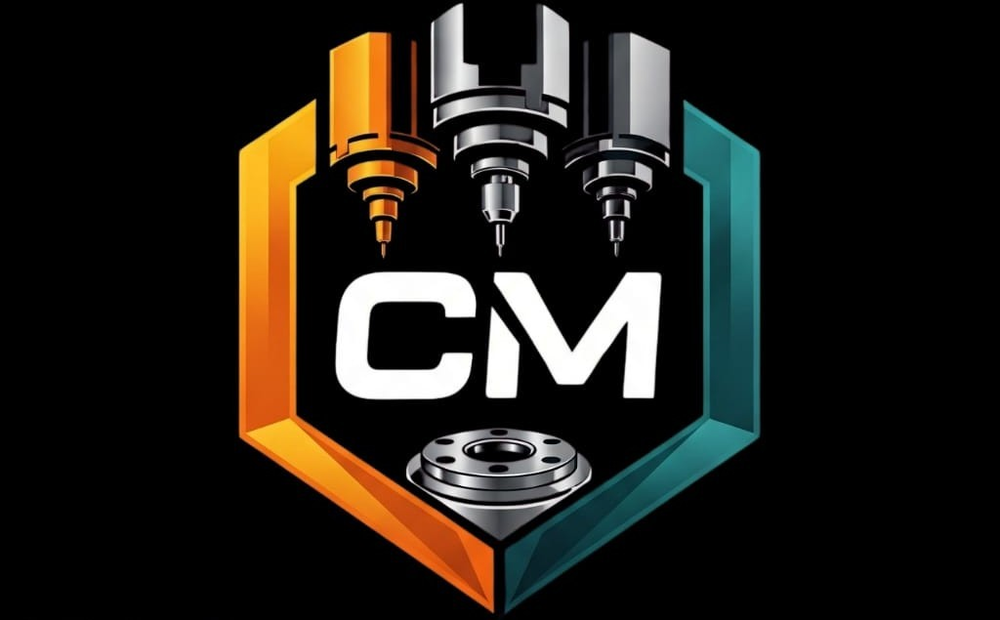

# CM SOLUTION - CNC & Industrial Solutions

Website institucional e catálogo dinâmico de equipamentos CNC, centros de usinagem e tornos industriais para a **CM SOLUTION**.

## 🚀 Sobre o Projeto

A **CM SOLUTION** atua no fornecimento de máquinas operatrizes (tornos CNC de barramento inclinado e paralelo, centros de usinagem verticais, centros 5 eixos e portais, e tornos convencionais mecânicos) em parceria técnica com marcas de ponta (como Feeler, Euron e Quazar), aliando os equipamentos à consultoria de processos, mentoria de programação CNC e capacitação operacional in-company liderada pelo **Prof. Carlos Melo**.

## ✨ Funcionalidades

- **Identidade Visual Dual-Tone:** Alinhada ao logotipo oficial em Laranja Industrial (`#FF7A00`), Ciano de Precisão (`#00B4D8`) e acabamento em grafite/titânio escuro.
- **Catálogo Dinâmico de Máquinas:** Fotografias reais em alta resolução com especificações técnicas detalhadas.
- **Filtros por Categoria & Busca em Tempo Real:** Filtragem instantânea por Tornos CNC, Centros de Usinagem, Tornos Convencionais e Centros 5 Eixos.
- **Ficha Técnica Interativa (Modal Lightbox):** Modal com tabela de cursos, rotações, cone de árvore, avanço rápido e comando numérico.
- **Calculadora de Produtividade CNC:** Simulador interativo onde o visitante estima a redução de tempo de ciclo e horas liberadas de máquina por mês.
- **Gerador Inteligente de Cotação para WhatsApp:** Formulário com pré-preenchimento automático para envio direto ao WhatsApp comercial.
- **FAQ Técnico:** Dúvidas comuns sobre instalação, entrega técnica, financiamentos (Finame/BNDES) e treinamentos operacionais.
- **Design 100% Responsivo:** Adaptado com menu mobile para smartphones, tablets e desktops.

## 🛠️ Tecnologias Utilizadas

- **HTML5 Semântico**
- **CSS3 Moderno** (Flexbox, Grid, Variáveis CSS, Glassmorphism e animações)
- **Vanilla JavaScript (ES6+)** (Sem dependências externas pesadas)

## 📞 Contatos Oficiais

- **Telefone:** +55 (11) 95844-6116
- **WhatsApp:** (11) 94361-9085
- **E-mail:** prof.carllosmelo@gmail.com
- **Responsável:** Prof. Carlos Melo
